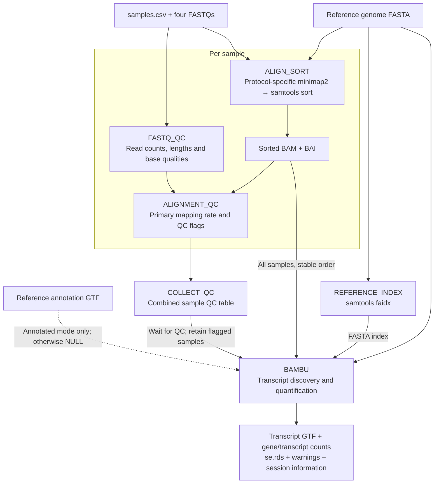

# Task 5: long-read RNA-seq with Nextflow

A small, custom Nextflow DSL2 pipeline for the four assignment samples. 

## Understand the workflow



- A **process** declares its inputs, outputs, resource requests and shell command.
- A **channel** carries files/metadata between processes. Nextflow launches work
  when the necessary inputs are available.
- `samples.csv` records the protocol explicitly rather than guessing from names.
- Each FASTQ produces its own sorted, indexed BAM. Minimap2's SAM output streams
  directly to `samtools sort`, which converts and sorts it into BAM; no large SAM
  file is saved. Bash `pipefail` propagates failures from either command.
- Direct RNA: `minimap2 -ax splice -uf -k14 -t 4`.
- cDNA: `minimap2 -ax splice -t 4`.
- Sorting: `samtools sort -@ 1 -m 1G`; indexing and integrity checks follow.
- Bambu receives all BAMs in a stable sample order, with their indexes and the
  reference FASTA/index. Annotated mode calls `prepareAnnotations(gtf)`;
  unannotated mode explicitly passes `annotations=NULL`.
- Bambu uses `ncore=4`, `discovery=TRUE`, `quant=TRUE`, automatic NDR and other
  package defaults; `set.seed(4262)` is set. Its warnings and session information
  are saved. Seed setting alone does not guarantee all parallel code is deterministic.
- The mode switch only changes Bambu inputs/command. The upstream processes can
  therefore be cached. Helper scripts are declared as file inputs so changes to
  them invalidate the relevant task cache.

## Files

| File | Purpose |
|---|---|
| `main.nf` | Processes and their connections |
| `nextflow.config` | Paths, resource limits and QC thresholds |
| `samples.csv` | Four sample IDs, protocols, absolute FASTQ paths |
| `bin/fastq_qc.py` | Validate four-line FASTQ and calculate streaming metrics |
| `bin/summarise_qc.py` | Interpret primary alignment counts and flag samples |
| `bin/merge_qc.py` | Combine sample QC tables |
| `bin/run_bambu.R` | Annotation switch, discovery, quantification, exports |
| `env.sh` | Activate this VM's Java, Nextflow and R library |
| `compat/date` | Prefer installed GNU date for correct Nextflow timers |
| `run_scenario.sh` | Run one full scenario and retain execution evidence |
| `tests/` | Unit tests and real small-fixture integration tests |

## Environment

Validated on the assignment VM with Java 21, Nextflow 25.10.4, minimap2 2.27,
samtools 1.22.1, R 4.5.2 and Bambu 3.12.1. `setup_vm.sh` installs user-local Java
and Nextflow; R/Bambu/minimap2/samtools were already installed. The pipeline is
currently configured for this VM, not packaged in a portable container.

Ubuntu 26.04's uutils 0.8.0 `date +%s%3N` returned an incompatible timestamp.
`env.sh` prepends the project `compat/` directory so `compat/date` uses the
already-installed `/usr/bin/gnudate`; system utilities are not replaced.
Ensure `compat/date` retains its executable bit when copying the code.

## Run slowly, one scenario at a time

On the VM:

```bash
cd ~/task5
source env.sh
nextflow -version
bash run_scenario.sh annotated
```

The script prints the actual Nextflow command, preserves terminal output, and
writes `results/annotated/report.html`, `trace.tsv` and `timeline.html`. Wait for
`SUCCESS` and inspect the outputs before proceeding. Screenshot the command
and completed execution in your terminal.

Then:

```bash
bash run_scenario.sh unannotated
```

This passes `-resume <annotated-run-name>` explicitly. Expect 14 cached upstream
tasks (4 FASTQ QC, 4 alignment, 4 alignment QC, 1 reference index, 1 QC merge)
and one newly executed Bambu task. Preserve a screenshot showing the printed
`-resume` command and `Cached process` messages. The unannotated report and
trace are stored separately in `results/unannotated/`.

The scripts deliberately refuse to overwrite existing execution evidence. If a
run fails, inspect the error and its work directory first; a recovery command
should use `-resume` and new report/trace filenames. Do not simply delete the
work directory or claim a failed attempt was successful.

For a long session use a persistent terminal such as tmux if available. The
full-data runs have NOT been executed merely by building or smoke-testing this
project.

## Outputs

```text
results/
  annotated/                  # report.html, trace.tsv, timeline.html, terminal.log
  unannotated/                # separate execution evidence
  bam/                        # sorted BAMs, BAIs, minimap2 logs, versions
  qc/raw/                     # raw metrics JSON for each sample
  qc/alignment/               # flagstat JSON, MAPQ20 counts, sample QC TSVs
  qc/qc_summary.tsv           # all samples and screening reasons
  bambu/annotated/bambu_output/
  bambu/unannotated/bambu_output/
```

Each Bambu directory contains `extended_annotations.gtf`,
`counts_transcript.txt`, `counts_gene.txt`, `gene_counts.tsv`,
`fullLengthCounts_transcript.txt`, `uniqueCounts_transcript.txt`,
`CPM_transcript.txt`, `se.rds`, parameters, warnings and session information.
IDs inferred without annotations are not automatically matched to annotated
reference gene IDs.

**Published analysis outputs are symlinks** into Nextflow's `work/` directory,
saving disk space. Keep both `work/` and `.nextflow/` for `-resume`. Do not clean
them between scenarios. To archive selected results for submission, copy with
symlinks dereferenced (e.g. `cp -L` or `rsync -L`) and check available disk space.
Do not upload work directories or large raw data to the code repository.

## QC definitions and limitations

The declared sample screening thresholds are:

- at least **100,000 raw reads**;
- at least **70% primary mapped reads**.

These are pragmatic, configurable project thresholds, **not universal Nanopore
standards or proof of biological validity**. Read depth supports transcript
sampling; low mapping can signal short/poor-quality reads, contamination or
reference mismatch. A failure is a request for investigation, not a diagnosis.
Thresholds are recorded in the TSV and can be changed with `--min_reads` and
`--min_mapped_pct` in a direct Nextflow command.

Other reported metrics are total bases, min/max/mean/median read length, length
N50, arithmetic mean base Phred score, and primary MAPQ >=20 count/fraction.
Read length and base quality provide context but are not additional pass/fail
criteria here. An arithmetic mean Phred score is not a probability-averaged
read quality estimate. MAPQ is alignment confidence, not base quality.

The mapping percentage is:

```text
100 × primary mapped records / primary records
```

Secondary and supplementary alignments are excluded to avoid counting a read
multiple times. Counts from both SAM QC-flag categories are included; samtools'
`QC-passed reads` label is not our sample PASS verdict. MAPQ20 filtering excludes
flags 4, 256 and 2048 (`-F 2308`). The pipeline checks that primary-record count
matches FASTQ read count. Malformed/empty FASTQs or invalid BAMs stop execution;
sample screening failures do not. All four assignment samples remain in Bambu,
with any failing samples explicitly reported.

This QC does not establish RNA integrity, adapter removal, absence of
contamination, splice-junction accuracy, or biological reproducibility. Future
work could add NanoPlot/NanoQC, contamination checks, improved protocol-specific
criteria, filtering sensitivity analyses, containers and automated CI tests.

Before workflow construction, all four local FASTQ sizes and S3 ETags were
verified (8-MiB multipart ETags for the three large files). The very small
Hct116 directRNA file matches its public source. This verifies the download,
not the biological quality of its reads.

## Runtime interpretation

For Task 5.1 use each full-data `report.html` **Summary** wall-clock duration.
Record both values, their difference and, if desired, their ratio. Compare the
Bambu task timings separately using the report's task table. `trace.tsv` provides
additional evidence of `COMPLETED` versus `CACHED` tasks.

Scenario 1 executes the entire workflow; Scenario 2 reuses the upstream work.
Their wall-clock difference is therefore NOT an isolated measurement of how
annotations affect Bambu speed. Cached task durations in a trace refer to their
original execution, not fresh work done in Scenario 2. Do not sum those durations
as the resumed run's elapsed time.

## Tests (not assignment results)

```bash
python3 -m unittest discover -s tests -v
bash tests/smoke_test.sh
```

The smoke test uses Bambu's bundled chr9 example (129 reads), converts it back
to FASTQ, and uses that same fixture under two synthetic sample names solely to
exercise both alignment branches and the combined Bambu call. It is neither the
four assignment samples nor independent biological replicates. It runs both
annotation modes and asserts that all eight upstream test tasks are cached in
the second execution, while Bambu reruns. Results live under `tests/runs/` and
must not be submitted as evidence of full-dataset execution.

## References

- Nextflow: https://doi.org/10.1038/nbt.3820
- Minimap2: https://doi.org/10.1093/bioinformatics/bty191
- SAMtools: https://doi.org/10.1093/bioinformatics/btp352
- Bambu: https://doi.org/10.1038/s41592-023-01908-w
- SG-NEx: https://doi.org/10.1038/s41592-025-02623-4
